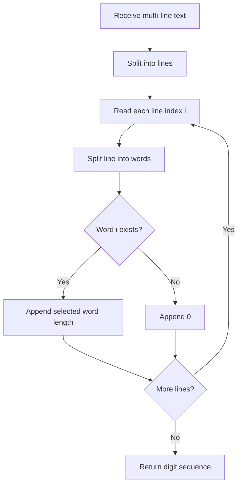

# Poem PIN Extractor

A small Python text-processing utility that creates a reproducible digit sequence from a multi-line text. For line index `i`, it measures the length of the word at word index `i`; if that word does not exist, it appends `0`.

The repository includes a browser interface that demonstrates the same algorithm locally.


## Live interface

After enabling **Settings → Pages → Build and deployment → GitHub Actions**, visit:

[Open the text extractor](https://aKmsdfhjb.github.io/poem-pin-extractor/)

## Example

Input:

```text
The sky is blue
Birds fly high
Nature is quite beautiful
```

- Line 1, word 1: `The` → 3
- Line 2, word 2: `fly` → 3
- Line 3, word 3: `quite` → 5

Output: `335`

## Flowchart



## Run locally

Python:

```bash
python main.py
```

Browser interface: open `index.html` in a modern browser. The interface processes text locally and does not upload it.

## Project structure

- `main.py` — `pin_extractor(poems)` and command-line interaction.
- `index.html` — interactive browser demonstration.
- `.github/workflows/pages.yml` — GitHub Pages deployment workflow.

## Security note

This is a deterministic educational text transformation, not a cryptographic function. Its output is predictable and must not be used as a real PIN, password or security credential.

## Documentation and Wiki

Use this README for the project guide. Longer notes can live under `docs/`. A native GitHub Wiki is separate from repository files and must be enabled in repository settings before pages can be added.

## License

MIT — see [LICENSE](LICENSE).
